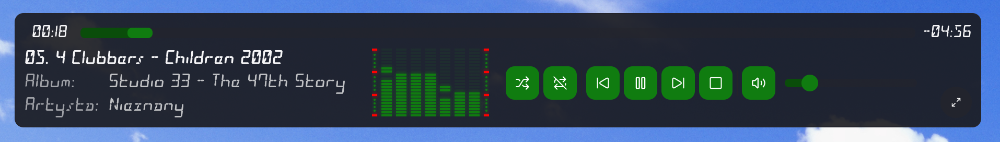

# VisualPlayer

[Polski](README_pl-PL.md)

VisualPlayer is a cross-platform desktop music player built with .NET and Avalonia. It is designed for listening to a local music collection while presenting the sound through configurable, real-time visualizations. Playback, the music library, queues, saved playlists, lyrics, equalizer presets, and interface customization are all available from one desktop application.

The main window keeps the visualization in the center and places the playback controls around it. The side panel expands only when needed, while the information bar, player, lyrics, logo, and visualization share the available space. Individual panels can be configured to remain visible or hide automatically.

> VisualPlayer is currently under active development. Interfaces, configuration formats, and behavior may change before a stable release.

## Application overview

VisualPlayer provides more than basic file playback. It can scan music folders, organize tracks by album and artist, maintain a current queue and independent saved playlists, process sound through a ten-band equalizer, and render audio data as configurable visualizations. Lyrics may be imported, edited, synchronized, downloaded, or read from supported audio metadata.

The interface uses reusable Avalonia controls and themes. Colors, backgrounds, opacity, panel behavior, keyboard shortcuts, visualization profiles, logo animation, and playback behavior can be adjusted without changing the application code.

### Main menu

The compact side panel provides access to the library, playlist manager, equalizer, lyrics, visualizations, and settings. It can expand to show item names and collapse back to an icon-only layout. The current playback queue can be opened in the same panel.

### Current playlist

The current playlist is the live playback queue. Tracks can be searched, sorted, selected, reordered with drag and drop, removed, imported from a playlist file, or exported. The panel can be resized and remains integrated with the main window layout.

### Mini player

The main window can switch to a compact, borderless mini-player layout. Transport and option buttons remain available at every supported width. Track titles and cover artwork appear progressively when more horizontal space is available. An optional seven-band VFD-style visualization remains visible down to the visualization-specific minimum width and offers Regular, Upside Down, Single, Center Filled, and Center Single modes.

The mini player can remain above other windows, show or hide its cover and visualization, and use an independently restricted background opacity. Topmost and visibility switches are available in its context menu, while the dedicated **Mini player** settings page contains the complete configuration. Returning to the full player always disables the active topmost window state without clearing the saved preference.

## Music library

Folders added in the settings are scanned for supported audio files. Each folder can optionally include its subdirectories. The library can then be browsed as tracks, albums, artists, or a directory tree.

The library supports multiple presentation sizes, search, context-sensitive sorting, multi-selection, and actions for playing tracks, appending them to the current queue, creating a playlist, or adding them to an existing playlist.

### Albums

Album browsing groups the collection using audio metadata and provides cover artwork when it is available.

### Tracks

The track view exposes the complete library in a detailed layout with titles, albums, artists, duration, artwork, and playback actions.

## Playlist management

Saved playlists are managed independently from the current queue. A playlist can be created, duplicated, searched, sorted, played, appended to the queue, imported, or exported. Its contents can be edited with multi-selection and drag and drop ordering. Unsaved changes are detected before leaving an edited playlist.

## Audio playback and equalizer

The player supports AAC, AIFF, ASF, FLAC, M4A, MP3, MP4, Ogg, Opus, WAV, and WMA files. Playback controls include:

- play, pause, stop, previous, and next track,
- shuffle and repeat modes,
- volume and mute controls,
- adjustable playback speed with configurable presets,
- optional crossfade between tracks,
- configurable keyboard shortcuts and system media commands.

The ten-band equalizer provides a preamp and filters centered at 60 Hz, 100 Hz, 200 Hz, 500 Hz, 1 kHz, 1.8 kHz, 3.4 kHz, 5.7 kHz, 9 kHz, and 13 kHz. Protected application presets can be used as supplied or cloned into editable user presets.

## Audio visualizations

Visualizations react to spectrum or waveform data produced by the audio analysis pipeline. Global settings control the sampled frequency range, FFT scaling, smoothing, gain, and other shared behavior. Each visualization profile then stores the options appropriate for its selected renderer.

Available visualizations include:

- Peaks, Peaks - Floating, Peaks - Floating Mirrored, and Peaks - Mirrored,
- Stripes and Stripes - Mirrored,
- Oscilloscope, Oscilloscope - Center, Oscilloscope - Double, and Oscilloscope - Filled,
- Waveform and Waveform - Mirrored,
- Circle - Stripes and Circle - Waveform.

Elements can use a solid color, a linear or radial gradient, or a rainbow. Depending on the renderer, additional options include animated gradients, direction, spacing, line thickness, gravity, filling, mirroring, circular radius, rotation, and position offsets. Built-in profiles are restored if they are missing or invalid, while custom profiles can be created and edited by the user.

## Lyrics

VisualPlayer maintains a local lyrics library associated with music tracks. Lyrics can come from adjacent LRC files, manually imported LRC or text files, embedded audio metadata, or LRCLIB. The application supports:

- plain text,
- line timestamps such as `[00:12.40]`,
- enhanced LRC word or syllable timestamps such as `<00:13.10>`,
- import and export appropriate to the lyrics type,
- an editor with precise playback positioning, configurable seek intervals, playback anchors, validation, undo and redo, and unsaved-change handling,
- a playback overlay with separate layouts for timed and plain lyrics,
- highlighting of the current line, word, or syllable when timing data is available.

## Appearance and configuration

The application offers light, dark, and system themes, configurable accent colors, custom window backgrounds, interface opacity, and several levels of interface colorization. The information bar, side panel, full player, mini player, and lyrics panel respond to window size and visibility settings.

An SVG logo can be displayed above the visualization. Its fill, border, opacity, scale, and bass-reactive animation can be configured independently. Keyboard shortcuts are editable for interface actions, playback, navigation, and visualization profile selection.

The information page reports the application name, version, author, bundled fonts with links to their authors, and included NuGet packages with their versions. Oxanium is used throughout the interface, while LED Sled and LED Counter 7 provide the player-display typography. Original font license/readme files are included in `VisualPlayer/Assets/Fonts`.

## Technical documentation

| Topic | English | Polski |
|---|---|---|
| Build, run, and publish | [Build guide](doc/build.md) | [Budowanie](doc/build_pl-PL.md) |
| Project organization and runtime flow | [Architecture](doc/architecture.md) | [Architektura](doc/architecture_pl-PL.md) |
| Playback, analysis, crossfade, and equalizer | [Audio system](doc/audio.md) | [System audio](doc/audio_pl-PL.md) |
| Renderers, profiles, colors, and global options | [Visualization system](doc/visualizations.md) | [System wizualizacji](doc/visualizations_pl-PL.md) |
| Sources, formats, storage, editor, and overlay | [Lyrics system](doc/lyrics.md) | [System tekstów](doc/lyrics_pl-PL.md) |
| Music scanning, queue, and saved playlists | [Library and playlists](doc/library-and-playlists.md) | [Biblioteka i playlisty](doc/library-and-playlists_pl-PL.md) |
| Configuration files, controls, themes, and shortcuts | [Configuration and UI](doc/configuration-and-ui.md) | [Konfiguracja i UI](doc/configuration-and-ui_pl-PL.md) |

## Technology

- .NET 10
- Avalonia 12
- MiniAudioEx
- TagLibSharp
- CommunityToolkit.Mvvm
- Lucide.Avalonia

## Project status

VisualPlayer is being developed as a desktop application and has not yet reached a stable public release. The current repository should be treated as a development version. See the [build guide](doc/build.md) for requirements and commands.

## Author

Copyright © Kamil Karpiński.
