# VisualPlayer

[English](README.md)

VisualPlayer jest wieloplatformowym odtwarzaczem muzyki dla komputerów, zbudowanym przy użyciu .NET i Avalonia. Służy do odtwarzania lokalnej kolekcji muzyki i prezentowania dźwięku za pomocą konfigurowalnych wizualizacji działających w czasie rzeczywistym. Odtwarzanie, biblioteka muzyki, kolejka, zapisane playlisty, teksty piosenek, presety equalizera i personalizacja interfejsu są dostępne w jednej aplikacji.

Główne okno pozostawia wizualizację w centrum i rozmieszcza wokół niej elementy sterowania odtwarzaniem. Panel boczny rozwija się wtedy, kiedy jest potrzebny, a panel informacji, odtwarzacz, tekst, logo i wizualizacja wspólnie wykorzystują dostępny obszar. Poszczególne panele mogą być stale widoczne albo automatycznie się ukrywać.

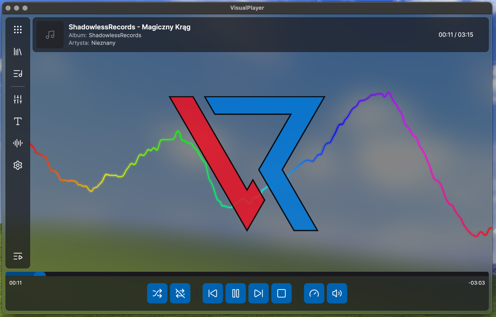

> VisualPlayer jest obecnie aktywnie rozwijany. Interfejsy, formaty konfiguracji i zachowanie aplikacji mogą zmienić się przed stabilnym wydaniem.

## Przegląd aplikacji

VisualPlayer oferuje więcej niż podstawowe odtwarzanie plików. Potrafi skanować katalogi z muzyką, porządkować utwory według albumów i artystów, utrzymywać bieżącą kolejkę oraz niezależne zapisane playlisty, przetwarzać dźwięk przez dziesięciopasmowy equalizer i renderować dane audio jako konfigurowalne wizualizacje. Teksty piosenek można importować, edytować, synchronizować, pobierać lub odczytywać z obsługiwanych metadanych audio.

Interfejs korzysta z wielokrotnego użytku kontrolek i motywów Avalonia. Kolory, tła, przezroczystość, zachowanie paneli, skróty klawiszowe, profile wizualizacji, animację logo oraz zachowanie odtwarzacza można zmieniać bez modyfikowania kodu aplikacji.

### Menu główne

Kompaktowy panel boczny udostępnia bibliotekę, manager playlist, equalizer, teksty, wizualizacje i ustawienia. Może rozwinąć się, pokazując nazwy pozycji, a następnie wrócić do układu zawierającego same ikony. W tym samym panelu można otworzyć bieżącą kolejkę odtwarzania.

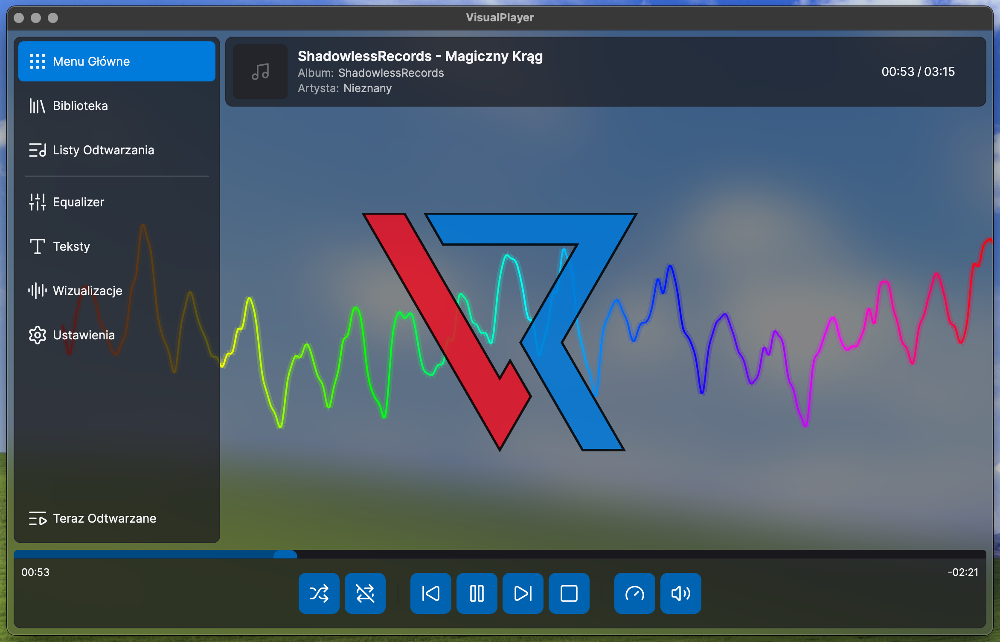

### Bieżąca playlista

Bieżąca playlista jest aktywną kolejką odtwarzania. Utwory można wyszukiwać, sortować, zaznaczać, przestawiać przez przeciąganie, usuwać, importować z pliku playlisty oraz eksportować. Panel ma regulowaną szerokość i pozostaje częścią układu głównego okna.

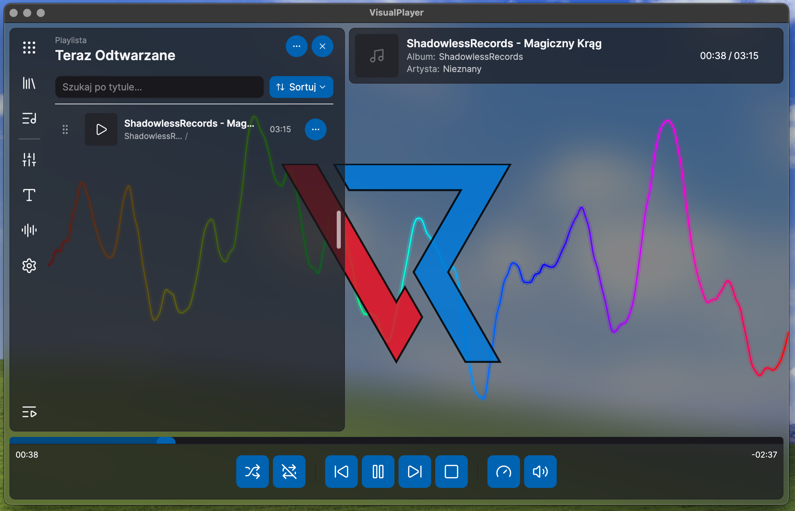

## Biblioteka muzyki

Katalogi dodane w ustawieniach są skanowane w poszukiwaniu obsługiwanych plików audio. Dla każdego katalogu można osobno włączyć uwzględnianie podkatalogów. Bibliotekę można następnie przeglądać jako utwory, albumy, artystów albo drzewo katalogów.

Biblioteka obsługuje kilka rozmiarów i układów elementów, wyszukiwanie, sortowanie zależne od widoku, zaznaczanie wielu pozycji oraz akcje pozwalające odtworzyć utwory, dodać je do bieżącej kolejki, utworzyć playlistę albo dołączyć je do istniejącej playlisty.

### Albumy

Widok albumów grupuje kolekcję na podstawie metadanych audio i pokazuje okładki, jeśli są dostępne.

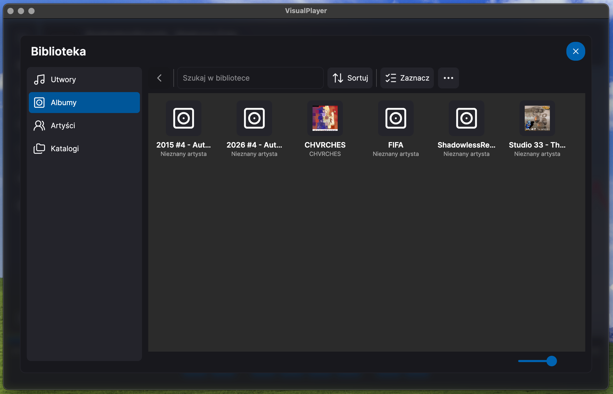

### Utwory

Widok utworów przedstawia całą bibliotekę w szczegółowym układzie z tytułami, albumami, artystami, czasem trwania, okładkami i akcjami odtwarzania.

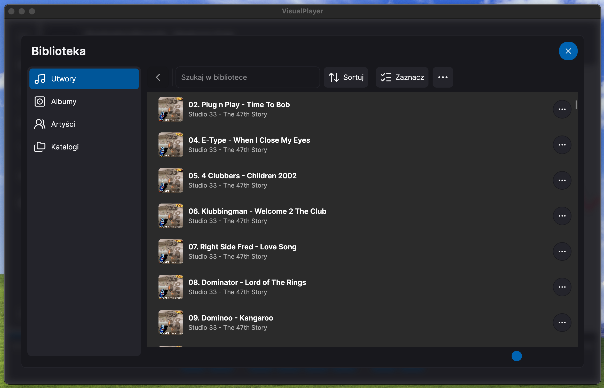

## Zarządzanie playlistami

Zapisane playlisty są zarządzane niezależnie od bieżącej kolejki. Playlistę można utworzyć, zduplikować, wyszukać, posortować, odtworzyć, dołączyć do kolejki, zaimportować lub wyeksportować. Jej zawartość można edytować z użyciem wielokrotnego zaznaczania i przeciągania pozycji. Przed opuszczeniem zmodyfikowanej playlisty aplikacja wykrywa niezapisane zmiany.

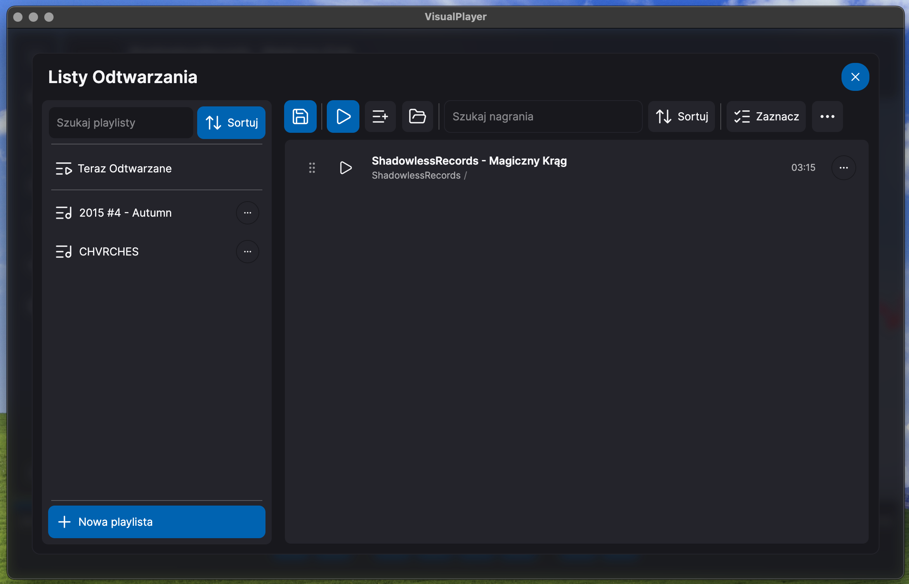

## Odtwarzanie i equalizer

Odtwarzacz obsługuje pliki AAC, AIFF, ASF, FLAC, M4A, MP3, MP4, Ogg, Opus, WAV i WMA. Sterowanie odtwarzaniem obejmuje:

- odtwarzanie, pauzę, zatrzymanie oraz poprzedni i następny utwór,
- tryb losowy i tryby powtarzania,
- regulację głośności i wyciszenie,
- zmianę szybkości odtwarzania z konfigurowalnymi presetami,
- opcjonalne płynne przejście pomiędzy utworami,
- konfigurowalne skróty klawiszowe i systemowe polecenia multimedialne.

Dziesięciopasmowy equalizer zawiera preamp oraz filtry o częstotliwościach środkowych 60 Hz, 100 Hz, 200 Hz, 500 Hz, 1 kHz, 1,8 kHz, 3,4 kHz, 5,7 kHz, 9 kHz i 13 kHz. Chronionych presetów aplikacji można używać bez zmian albo sklonować je do edytowalnego presetu użytkownika.

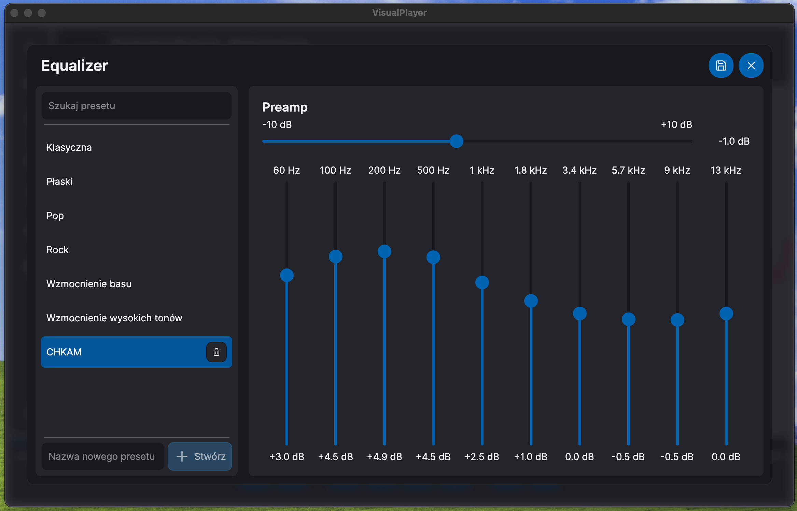

## Wizualizacje dźwięku

Wizualizacje reagują na widmo albo przebieg fali dostarczany przez system analizy audio. Ustawienia globalne określają zakres analizowanych częstotliwości, skalowanie FFT, wygładzanie, wzmocnienie oraz pozostałe wspólne zachowania. Każdy profil wizualizacji przechowuje następnie opcje właściwe dla wybranego sposobu renderowania.

Dostępne wizualizacje:

- Peaks, Peaks - Floating, Peaks - Floating Mirrored oraz Peaks - Mirrored,
- Stripes i Stripes - Mirrored,
- Oscilloscope, Oscilloscope - Center, Oscilloscope - Double oraz Oscilloscope - Filled,
- Waveform i Waveform - Mirrored,
- Circle - Stripes i Circle - Waveform.

Elementy mogą korzystać z jednolitego koloru, gradientu liniowego lub promienistego albo tęczy. Zależnie od wizualizacji dostępne są również animacje gradientu, kierunek, odstępy, grubość linii, grawitacja, wypełnienie, odbicie, promień okręgu, obrót i przesunięcie pozycji. Brakujące lub niepoprawne profile systemowe są odtwarzane, a użytkownik może tworzyć i edytować własne profile.

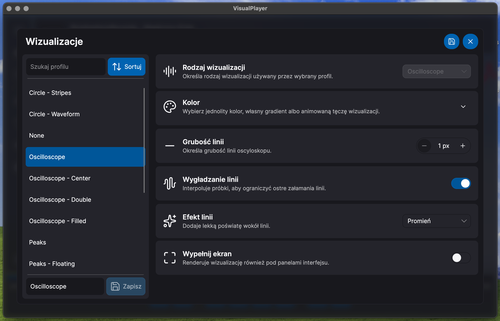

## Teksty piosenek

VisualPlayer prowadzi lokalną bibliotekę tekstów powiązanych z utworami. Teksty mogą pochodzić z sąsiednich plików LRC, ręcznie importowanych plików LRC lub tekstowych, metadanych audio albo LRCLIB. Aplikacja obsługuje:

- zwykły tekst,
- synchronizację linii, na przykład `[00:12.40]`,
- rozszerzony LRC z czasem słów lub sylab, na przykład `<00:13.10>`,
- import i eksport w formacie odpowiednim dla rodzaju tekstu,
- edytor z precyzyjnym ustawianiem pozycji, konfigurowalnymi interwałami przewijania, punktami wznowienia, walidacją, cofaniem i ponawianiem oraz wykrywaniem niezapisanych zmian,
- nakładkę podczas odtwarzania z osobnym układem dla tekstów czasowych i zwykłych,
- podświetlanie bieżącej linii, słowa albo sylaby, jeśli dostępne są odpowiednie dane czasowe.

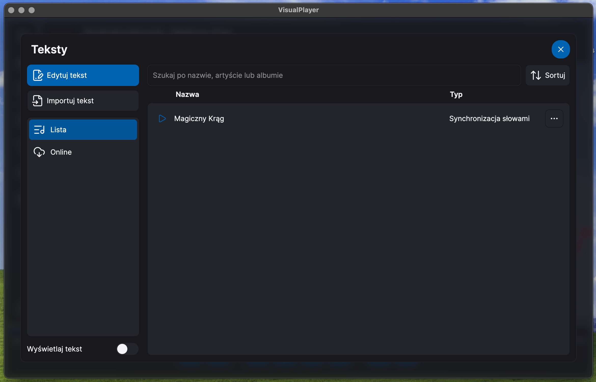

## Wygląd i konfiguracja

Aplikacja oferuje motyw jasny, ciemny i systemowy, konfigurowalne kolory akcentu, własne tła okna, przezroczystość interfejsu oraz kilka poziomów jego koloryzacji. Panel informacji, panel boczny, odtwarzacz i panel tekstu reagują na rozmiar okna oraz ustawienia widoczności.

Nad wizualizacją może być wyświetlane logo SVG. Jego wypełnienie, obramowanie, przezroczystość, skalę oraz animację reagującą na bas można konfigurować niezależnie. Skróty klawiszowe są edytowalne dla akcji interfejsu, odtwarzania, nawigacji i zmiany profilu wizualizacji.

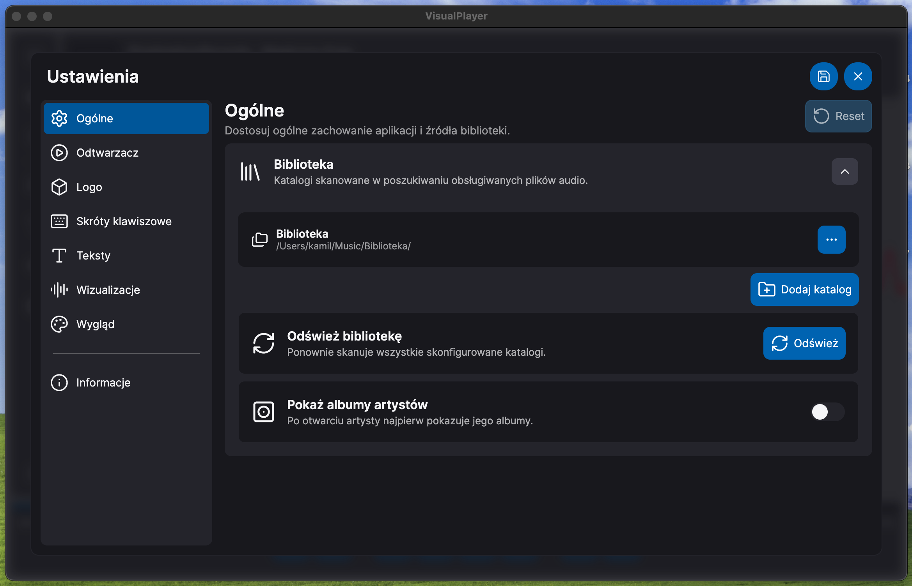

Zakładka informacji pokazuje nazwę i wersję aplikacji, autora oraz używane pakiety NuGet wraz z ich wersjami.

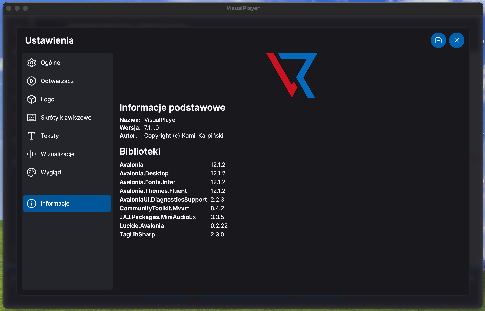

## Dokumentacja techniczna

| Temat | Polski | English |
|---|---|---|
| Budowanie, uruchamianie i publikowanie | [Budowanie](doc/build_pl-PL.md) | [Build guide](doc/build.md) |
| Organizacja projektu i przepływ działania | [Architektura](doc/architecture_pl-PL.md) | [Architecture](doc/architecture.md) |
| Odtwarzanie, analiza, przejścia i equalizer | [System audio](doc/audio_pl-PL.md) | [Audio system](doc/audio.md) |
| Renderery, profile, kolory i opcje globalne | [System wizualizacji](doc/visualizations_pl-PL.md) | [Visualization system](doc/visualizations.md) |
| Źródła, formaty, zapis, edytor i nakładka | [System tekstów](doc/lyrics_pl-PL.md) | [Lyrics system](doc/lyrics.md) |
| Skanowanie muzyki, kolejka i zapisane playlisty | [Biblioteka i playlisty](doc/library-and-playlists_pl-PL.md) | [Library and playlists](doc/library-and-playlists.md) |
| Pliki konfiguracji, kontrolki, motywy i skróty | [Konfiguracja i UI](doc/configuration-and-ui_pl-PL.md) | [Configuration and UI](doc/configuration-and-ui.md) |

## Technologie

- .NET 10
- Avalonia 12
- MiniAudioEx
- TagLibSharp
- CommunityToolkit.Mvvm
- Lucide.Avalonia

## Stan projektu

VisualPlayer jest rozwijany jako aplikacja komputerowa i nie osiągnął jeszcze stabilnego publicznego wydania. Bieżące repozytorium należy traktować jako wersję rozwojową. Wymagania i polecenia znajdują się w [instrukcji budowania](doc/build_pl-PL.md).

## Autor

Copyright © Kamil Karpiński.
